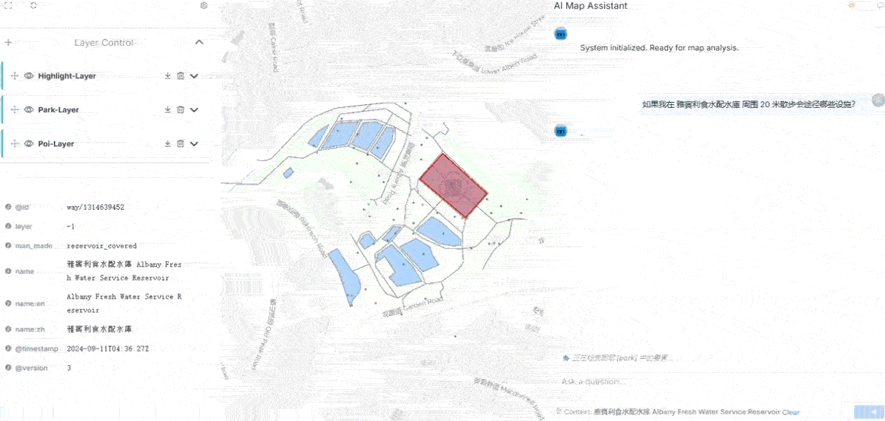

# GeoAI Professional Service

基于 AI 的地理空间分析工具，利用 GIS 数据与智能代理提供地块分析、空间计算和可视化服务。



## 功能特性

- AI 驱动的 GIS 分析（基于 DeepSeek 模型）
- 空间数据加载与处理（GeoJSON 格式）
- 实时可视化输出（地图与图表）
- 流式响应与状态推送（SSE）
- 前后端分离架构

## 技术栈

### 后端
- Python 3.12
- FastAPI（Web 框架）
- Pydantic AI（AI Agent 框架）

### 前端
- Vue 3 + Vite
- Element Plus（UI 组件）
- Deck.gl + MapLibre GL（地图可视化）
- Pinia（状态管理）

## 环境要求

- **Python**: 3.12
- **Node.js**: 18+ （前端开发）
- **包管理工具**: uv（Python）、pnpm/npm（前端）
- **API 密钥**: DeepSeek API（可选；未配置时自动进入本地演示模式，见下文）

> 💡 **没有 API Key 也能跑**：`.env` 中未填写有效 `DEEPSEEK_API_KEY` 时，后端会自动切换到
> `GEOAI_MOCK` 演示模式——用确定性的本地逻辑模拟检索与可视化，完整走通前端 → SSE → 地图渲染链路，
> 但不会调用大模型、不产生 token 费用。配置真实 Key 后自动恢复实时 AI 分析（也可用 `GEOAI_MOCK=0` 强制）。

## 快速启动

### 1. 安装 uv（如未安装）

```bash
# macOS / Linux
curl -LsSf https://astral.sh/uv/install.sh | sh

# Windows (PowerShell)
powershell -c "irm https://astral.sh/uv/install.ps1 | iex"
```

### 2. 克隆项目并安装后端依赖

```bash
git clone <your-repo-url>
cd <project-folder>

# uv 会按 .python-version 自动准备 Python 3.12，并根据 uv.lock 安装全部依赖
uv sync
```

### 3. 配置环境变量

```bash
cp .env.example .env
```

编辑 `.env` 文件：

```env
DEEPSEEK_API_KEY=your-api-key-here
```

### 4. 启动后端服务

```bash
uv run python -m src.main
```

后端服务将在 `http://localhost:8000` 运行。

### 5. 启动前端

```bash
# 安装前端依赖
npm install

# 启动开发服务器（纯 Vue + Vite，无 SSR）
npm run dev

# 类型检查 / 生产构建 / 本地预览
npm run type-check
npm run build
npm run preview
```

前端为 TypeScript + Vue 3 + Vite（无 SSR），`build` 脚本会先运行 `vue-tsc --noEmit` 再打包。

## Demo 数据获取

香港 Demo 数据来自香港政府开放数据的 GitHub 镜像 [`funglkf/hk-geodata`](https://github.com/funglkf/hk-geodata)；18 区边界来自 [`Paulkit/HKMap`](https://github.com/Paulkit/HKMap)。脚本可重复执行（边界脚本需要 `shapely`）：

```bash
.venv/Scripts/python scripts/prepare_hk_green_space.py   # 绿地：224 点（前端默认可见）
.venv/Scripts/python scripts/prepare_hk_layers.py        # 其余主题：约 13,872 点（已去重/瘦身）
.venv/Scripts/python scripts/prepare_hk_districts.py     # 18 区边界（面）
# uv run python scripts/prepare_hk_layers.py health sports   # 也可只抓指定主题
```

`prepare_hk_layers.py` 产出 6 个主题图层（均为 Point，统一含 `category`、`name`、`name_zh`、`district`、`address` 等字段）：

| 图层 | 点数 | 体积 | 主要分类 |
| --- | --- | --- | --- |
| `data/hk-environment.json` | 2,699 | 1.05 MB | 空气监测站、气象站、废物/回收设施、海洋公园、红潮 |
| `data/hk-health.json` | 385 | 0.19 MB | 医院、诊所、普通/专科门诊、地区健康中心 |
| `data/hk-education.json` | 2,087 | 0.94 MB | 幼儿园、中小学、大学、国际学校 |
| `data/hk-sports.json` | 753 | 0.39 MB | 泳池、体育馆、球场、海滩、自行车场地、博物馆 |
| `data/hk-services.json` | 2,862 | 1.14 MB | 图书馆、邮局、公市场、警署、街邮箱、智慧灯柱 |
| `data/hk-wifi.json` | 5,086 | 2.36 MB | Wi-Fi 热点 |

每个图层附带 `data/meta/hk-<主题>.meta.json`（bbox、分类计数、去重数量、数据来源）。这些文件位于 `data/` 顶层，后端 `list_layers` 可直接发现；前端注册为 `hk-<主题>-Layer`，**默认关闭**，在左侧图层面板中按需打开。元数据放在 `data/meta/` 子目录，避免被误识别为图层。

**轻量化处理**：抓取时按「分类 + 名称 + 5 位小数坐标」去重（共移除 789 个冗余点）、跳过全空字段、坐标保留 5 位小数（约 1 米精度）。6 个图层合计从 8.13 MB 降到 6.07 MB。前端不再静态 import 这些数据，而是用 `import.meta.glob` 按需加载独立 chunk，主 JS 包从 10 MB 降到 3.67 MB（gzip 1.8 → 0.98 MB）。

`prepare_hk_districts.py` 产出 `data/demo/hk-districts.json`（18 个区界面，已做轻量简化）与同名 `.meta.json`。前端注册为 `hk-districts-Layer`，默认可见并绘制在点上方的底层；地图图例中的「区界」按钮可开关它，「全港概览」按钮会缩放到行政区范围。

## API 接口

### 聊天分析接口

`POST /api/chat`

**请求体**：

```json
{
  "query": "分析这个区域的绿地分布",
  "history": []
}
```

**响应**：Server-Sent Events（SSE）流式响应

- `status`: 处理状态更新
- `final_result`: 最终分析结果（包含报告和 GeoJSON 数据）
- `error`: 错误信息

## 项目结构

```
├── src/
│   ├── main.py           # FastAPI 应用入口
│   ├── agent.py          # AI Agent 定义
│   ├── schema.py         # 数据模型与依赖注入
│   └── ...
├── data/                 # GeoJSON 数据文件
│   ├── hk-environment.json   # 环境/气象/废物（2,699 点）
│   ├── hk-health.json        # 医疗设施（385 点）
│   ├── hk-education.json     # 教育机构（2,087 点）
│   ├── hk-sports.json        # 体育休闲（753 点）
│   ├── hk-services.json      # 公共服务（2,862 点）
│   ├── hk-wifi.json          # Wi-Fi 热点（5,086 点）
│   ├── demo/                 # 绿地 Demo（公园/休憩用地/郊野公园，224 点）
│   └── meta/                 # 各图层的 bbox/计数/来源元数据
├── docs/
│   ├── src/              # 前端源码
│   └── records/          # AI 分析流程跑通记录（SSE 事件流 + 报告）
├── .env.example          # 环境变量示例
├── pyproject.toml        # Python 依赖声明
├── uv.lock               # 依赖锁定文件
└── README.md
```

## 核心功能说明

### 1. 智能分析流程
- 用户输入查询 → AI Agent 解析意图
- 自动调用 GIS 工具（空间查询、缓冲区分析等）
- 实时推送处理状态
- 返回分析报告 + GeoJSON 可视化数据

### 2. 可视化输出
后端返回的 `geojson` 字段为标准 FeatureCollection 格式，可直接被前端 Deck.gl 渲染：

```json
{
  "type": "FeatureCollection",
  "features": [...]
}
```

## 分析流程验证

可用 `scripts/run_analysis_smoke.py` 跑通一次完整的 SSE → Agent → GIS 工具 → 报告/GeoJSON 链路，并把原始事件流与摘要写入 `docs/records/`（该目录为调试产物，不纳入版本库）。

```bash
# mock 模式（无需 key）
$env:GEOAI_MOCK='1'   # macOS/Linux: export GEOAI_MOCK=1
.venv/Scripts/python.exe -m uvicorn src.main:app --port 8001
.venv/Scripts/python.exe scripts/run_analysis_smoke.py --url http://127.0.0.1:8001/api/chat

# live 模式（需 .env 中配置有效 DEEPSEEK_API_KEY）
.venv/Scripts/python.exe -m src.main
.venv/Scripts/python.exe scripts/run_analysis_smoke.py
```